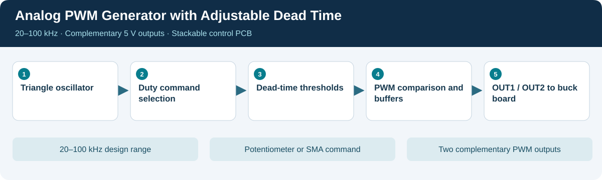
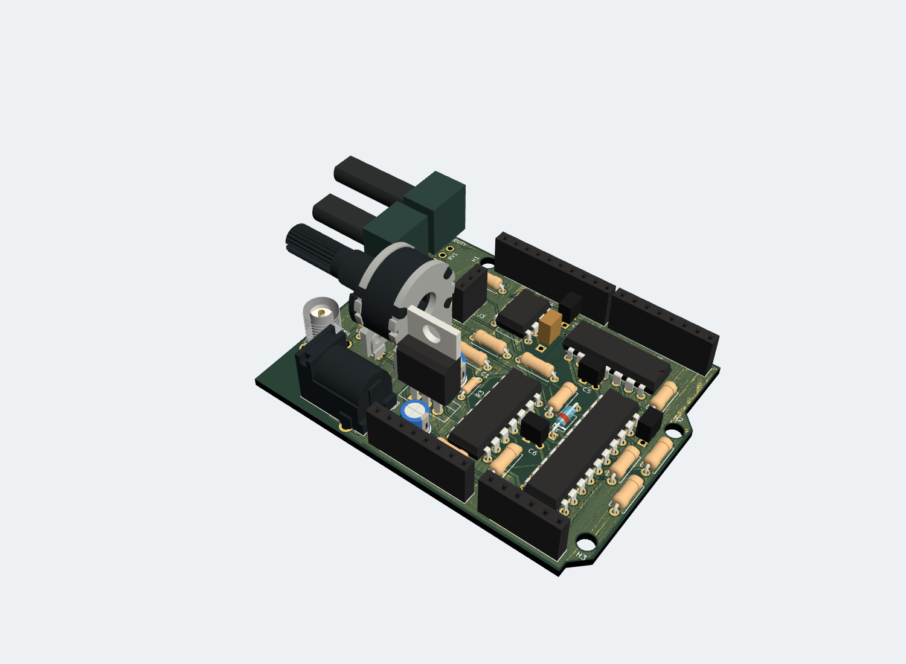
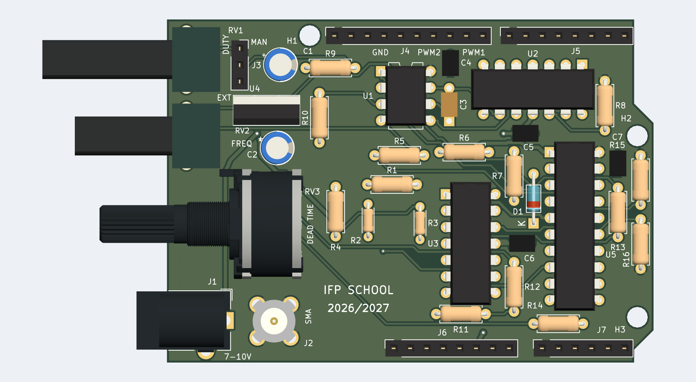
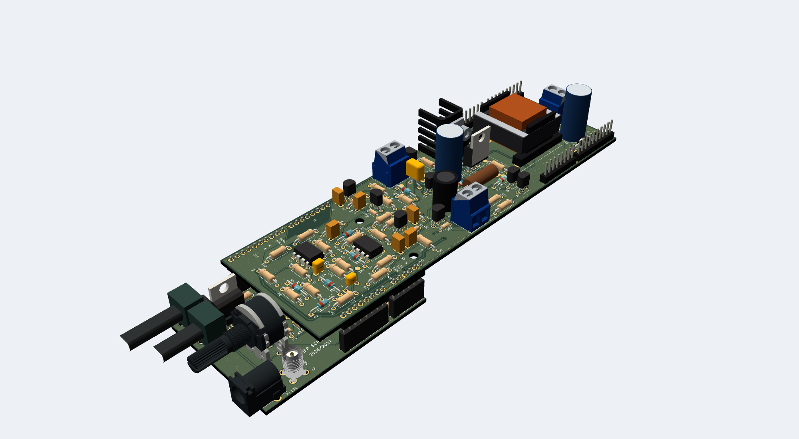
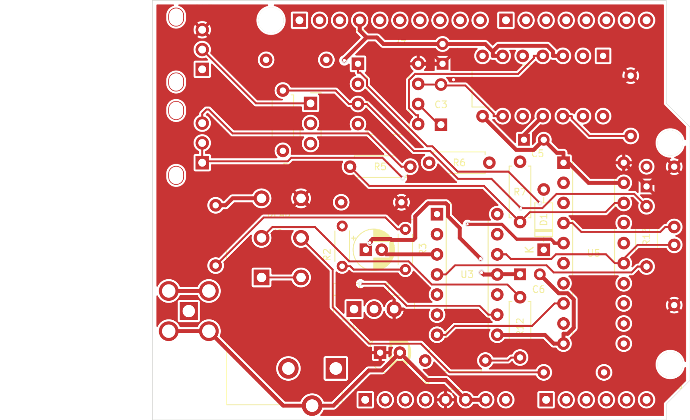
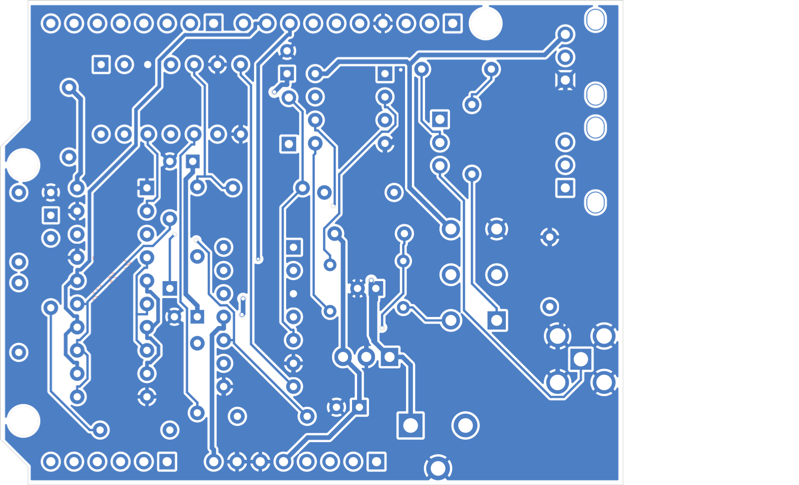
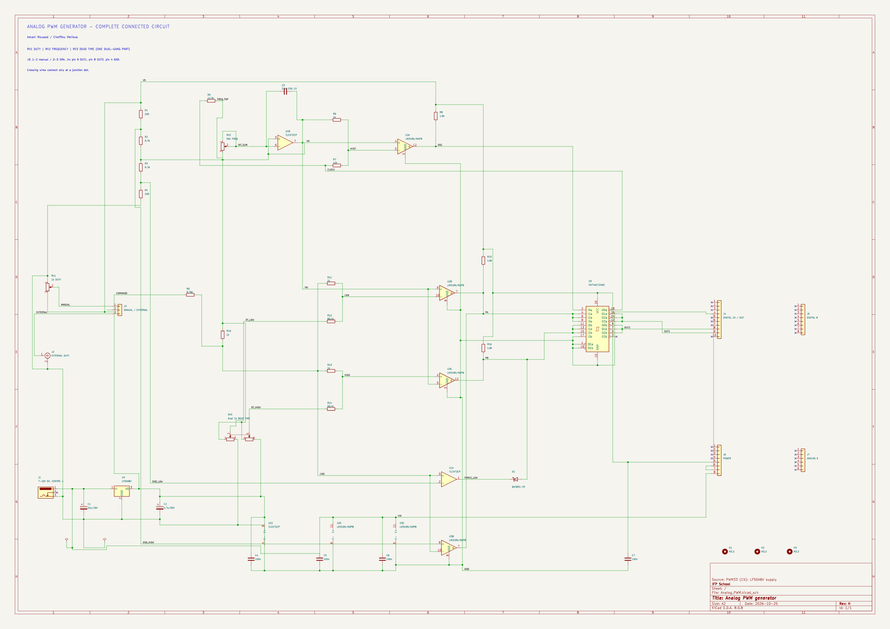
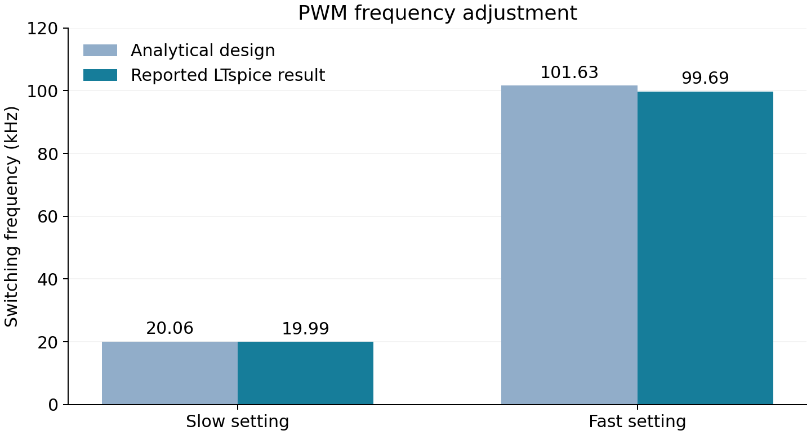

# Analog PWM Generator with Adjustable Dead Time

**20–100 kHz · Complementary 5 V outputs · Stackable control PCB**

An analog PWM generator with adjustable frequency, duty cycle and dead time. The circuit uses a shared triangular carrier, comparison thresholds and output buffers. Its stackable PCB supplies the switching commands for the [58 W synchronous buck converter](https://github.com/MouaadO/synchronous-buck-converter), the second project in the electric-scooter auxiliary-power system.

**Project team:** Amani Mouaad and Cheiffou Melissa.  
**IFP SCHOOL · Powertrain · 2026/2027**

## The control half of a two-board system

The PWM board handles the low-level timing commands. The buck power board receives those commands through the Uno Rev3-compatible headers and drives its two power MOSFETs. Keeping the boards separate makes the timing circuit easy to adjust and the power stage easy to inspect.

| Function | Design target |
|---|---|
| Outputs | Two complementary PWM signals |
| Switching frequency | 20–100 kHz |
| Duty command | 0–100%, selected from a potentiometer or external SMA input |
| Dead-time adjustment | Up to 10% of the switching period |
| Logic levels | Nominal 0 V / 5 V |
| Drive current | More than 20 mA source and sink per output |
| Supply | 7–10 V DC, centre-positive barrel jack |

## How the signal becomes PWM

1. **Carrier generation:** An integrator produces a rising/falling triangular voltage. A comparator with hysteresis reverses the clock at the carrier limits.
2. **Command selection:** The selector chooses the duty potentiometer or the external SMA command.
3. **Threshold generation:** A resistor network combines the command with the dead-time setting to establish two comparison levels.
4. **Comparison:** The triangle crosses those levels at different instants, creating the two complementary pulse allocations and their non-overlap intervals.
5. **Output drive:** The buffer stages drive OUT1 and OUT2. Endpoint detectors establish constant states for external commands outside the operating interval.

## Oscillator and timing equations

For timing resistance $R_t$ and integrator capacitor $C_{INT}$:

$$I=\frac{CLOCK-V_m}{R_t},\qquad
\frac{dV_{TRI}}{dt}=-\frac{I}{C_{INT}}$$

The comparator limits and the integrator slope determine the period. For the chosen resistor ratio, the nominal frequency relation is:

$$f\simeq\frac{3}{R_tC_{INT}}$$

The shared carrier keeps the frequency, command and dead-time comparison tied to one switching period. Detailed threshold and frequency calculations are in the [design notes](docs/design-notes.md).

## Current stackable PCB

The current board is **75 × 53 mm**, with a 7 mm extension on the potentiometer side. The extension places the outward-facing controls, regulator and input connectors in the exposed area of the two-board assembly. The 32 mating contacts retain the official Uno Rev3 pattern.

### Top 3D view

### Header connections to the buck board

| Signal | PWM-board pad | Uno contact |
|---|---|---|
| OUT1 / PWM1 | J4 pin 9 | D9 |
| OUT2 / PWM2 | J4 pin 8 | D10 |
| Common ground | J4 pin 4; J6 pins 6–7 | GND |

The upper board is the [synchronous buck converter](https://github.com/MouaadO/synchronous-buck-converter). Its battery input and 12 V gate-driver supply use separate power terminals.

### Front and back layers

| Front copper | Back copper |
|---|---|
|  |  |

Signal tracks use 0.25 mm widths, PWM output routes 0.40 mm, and supply/ground routes 0.50 mm. The front copper fill distributes 5 V; the back fill provides ground. Local footprints and bundled models define the potentiometers, connectors and IC packages.

### Complete schematic

## Recorded LTspice results

The existing simulation uses the 7805 supply model. The PCB assembly uses the selected LF50ABV regulator. The following values are the recorded **LTspice results** for the supplied simulation settings:

| Quantity | Result |
|---|---:|
| Frequency endpoints | 19.99 kHz / 99.69 kHz |
| Output LOW / HIGH | 0.082 V / 4.916 V |
| Source/sink current | Approximately 26.86 mA per output |
| Fast-setting non-overlap gaps | 0.980 µs / 0.984 µs |

## Open and run

For the hardware, open [pcb/Analog_PWM.kicad_pro](pcb/Analog_PWM.kicad_pro) in KiCad 8 or newer. In PCB Editor, press **Alt+3** for the 3D viewer. Keep the local symbol library, footprint library, tables and `3dmodels` folder beside the project.

For simulation, open `simulation/analog_pwm_dead_time.asc` in LTspice and run its transient analysis. Probe `TRI`, `CMD`, `LOW`, `HIGH`, `OUT1` and `OUT2`. Parameters `FP`, `DP`, `DTP`, `SOURCE` and `VD` select the operating settings.

## Files and tools

| Location | Contents |
|---|---|
| `pcb/` | KiCad schematic, board, local libraries, assembly BOM and purchasing workbook |
| `pcb/Manufacturing/` | Gerbers and plated/non-plated drill outputs |
| `simulation/` | LTspice schematic, symbols and component libraries |
| [Design notes](docs/design-notes.md) | Oscillator, duty and threshold calculations |
| `docs/images/` | PCB, schematic and stacked-system renders |
| `docs/datasheets/` | Component datasheets |

**Tools:** LTspice, KiCad, manufacturer package drawings and local 3D models.

## Related projects

[58 W Synchronous Buck Converter](https://github.com/MouaadO/synchronous-buck-converter) · [Inverter Modulation and PWM](https://github.com/MouaadO/inverter-pwm-experimental-validation)
