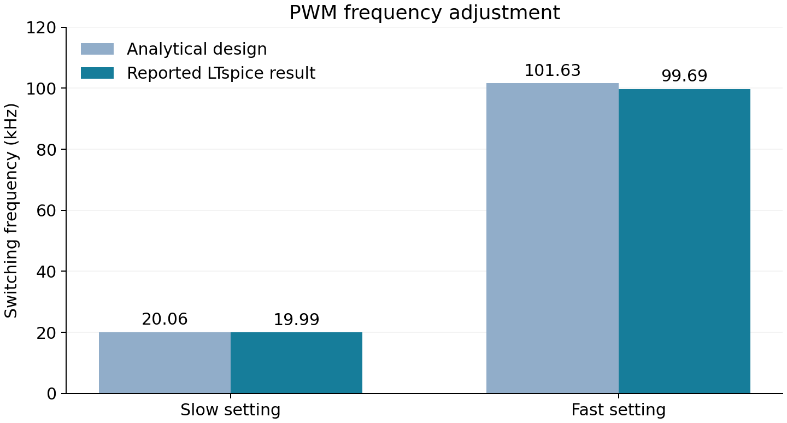

# Analog PWM Generator with Adjustable Dead Time

An LTspice circuit project that produces complementary PWM outputs from a shared triangle waveform. It combines adjustable frequency and duty cycle with threshold-based dead-time control.

## What it does

- Generates a triangle carrier and two complementary PWM signals.
- Adjusts switching frequency, duty cycle and dead time.
- Supports a potentiometer or external command input.
- Uses endpoint detection to set constant output states outside the command range.

## Results

The chart compares analytical design frequencies with the nominal LTspice results recorded in the [design notes](docs/design-notes.md).

| Reported nominal simulation result | Value |
| --- | --- |
| Switching frequency endpoints | 19.99 kHz and 99.69 kHz |
| Output LOW / HIGH levels | 0.082 V / 4.916 V |
| Source and sink current | Approximately 26.86 mA per output |
| Fast-setting dead-time gaps | 0.980 / 0.984 microseconds |

## Tools

LTspice, SPICE device models, custom circuit symbols and functional models.

## Run

1. Open `simulation/analog_pwm_dead_time.asc` in LTspice.
2. Run the transient analysis and probe `TRI`, `CMD`, `LOW`, `HIGH`, `OUT1` and `OUT2`.
3. Adjust `FP`, `DP`, `DTP`, `SOURCE` and `VD` to explore frequency, duty, dead time and command settings.

Keep the supplied symbols and libraries beside the schematic.

## Project files

- `simulation/`: circuit schematic, symbols and component models.
- [Design notes](docs/design-notes.md): operating principle and recorded simulation results.
- [Component bill of materials](docs/component-bill-of-materials.xlsx).
- `docs/datasheets/`: manufacturer component documentation.

Developed as a collaborative academic engineering project.
